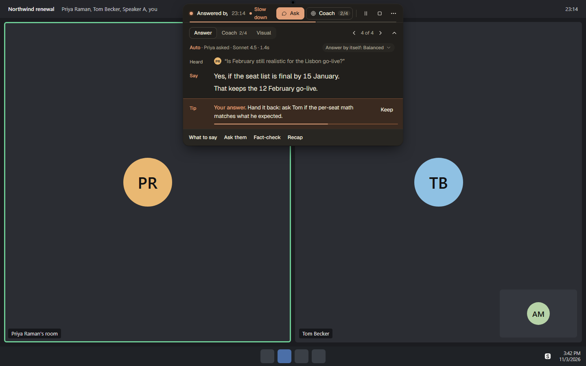
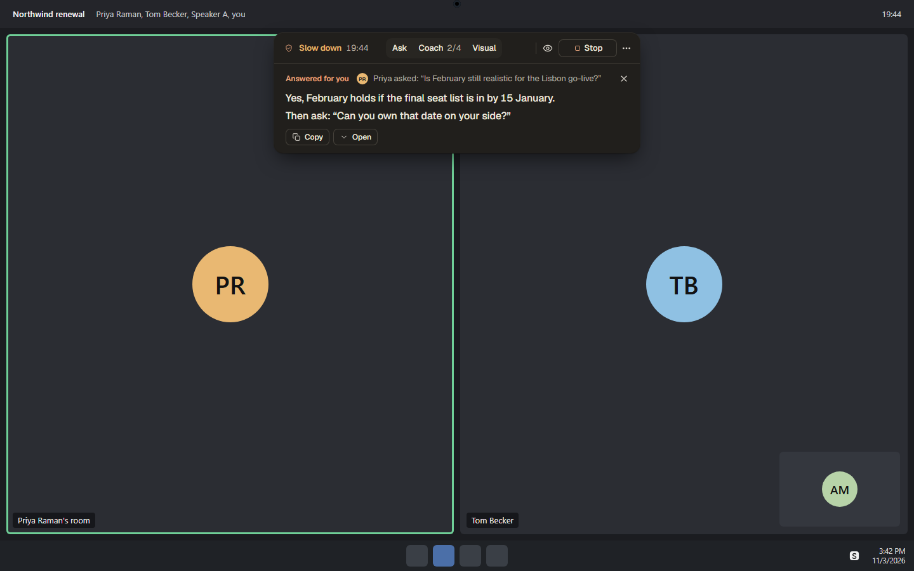
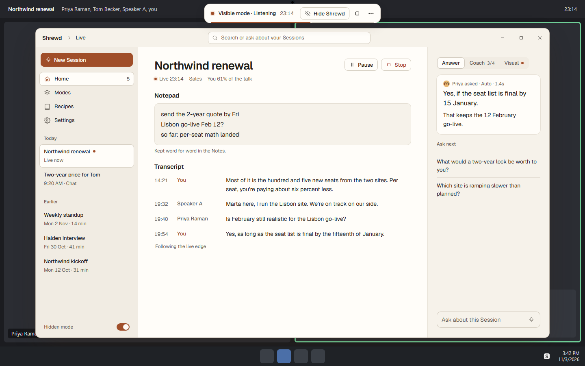
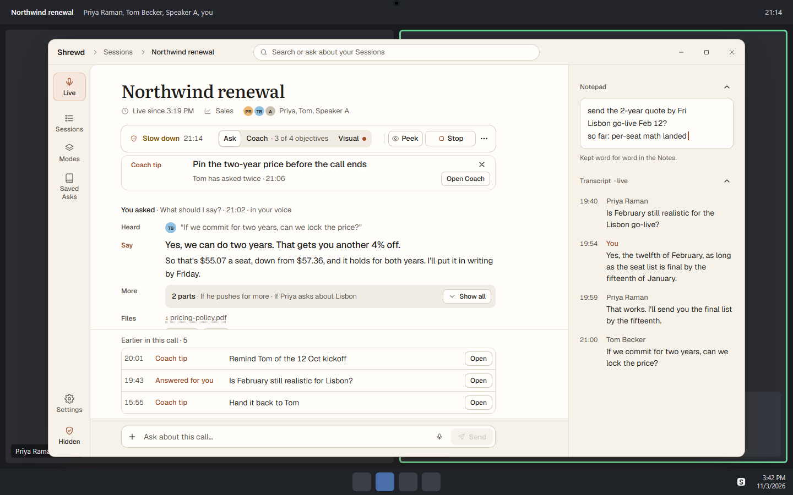
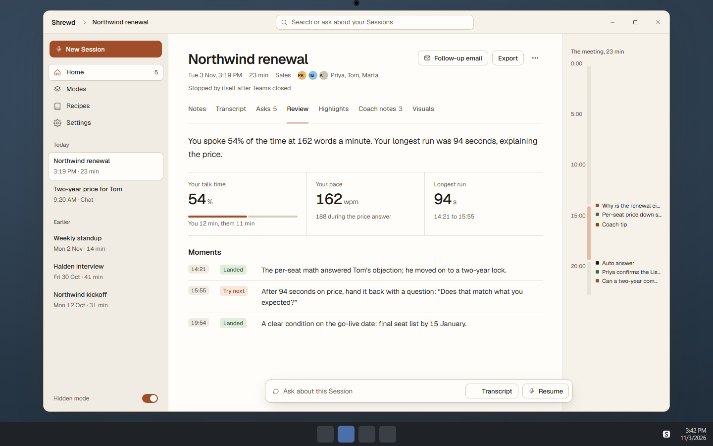
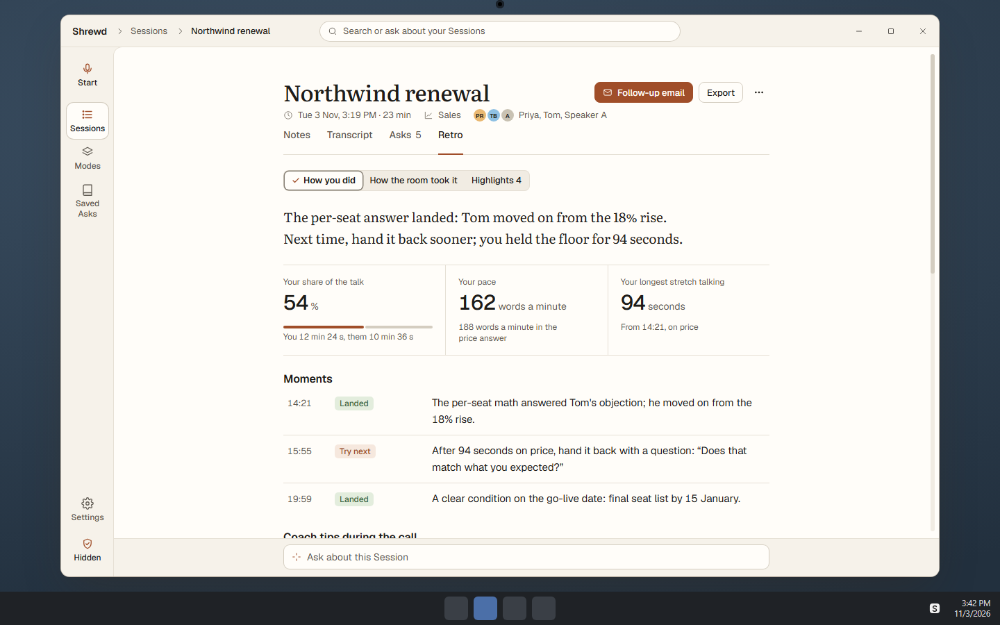

# ui-climb

An agent skill for climbing a UI design to "great" with two AI judges instead of a human reviewer.

Each **round**, two independent judges from two different model providers (Claude Opus, and GPT Sol through Codex) score your design's screenshots on a fixed rubric, against the apps you want to beat. A script, not the agent, computes the verdict from the saved scores. **Between rounds**, the agent interviews both judges until they sign a **contract** of exactly what will move each score, then builds to it.

The climb is done when both judges put every category of every cell at 9 or above and your design beats every benchmark app in every category it shares with them, not just on the mean.

It was built for, and proven on, [Shrewd](#example-shrewd-19-rounds), a Windows meeting assistant: 61 screens, 18 cells, 19 rounds, from 7.4 to 9.3.

## What's in it

```
skills/
  ui-climb/
    SKILL.md              the method: members, round folder, judge interviews, verdict
    scripts/climb.ts      computes each round's verdict from the saved files
    scripts/climb.test.ts the verdict's rules, plus the Shrewd example as a fixture
    templates/            rubric.json, brief.md, interview.md, contract.md
  council/                Theo Browne's council skill (t3dotgg/tstack), unchanged, MIT
examples/shrewd/          real rounds from the Shrewd climb (see below)
```

`ui-climb` depends on `council`, which is vendored here unchanged with its license.

## Set it up with Claude

Open Claude Code (or Codex) in the project whose UI you want to climb, and paste:

```text
Set up the ui-climb skill from https://github.com/myn/ui-climb in this project:
clone it to a temp folder, copy skills/ui-climb and skills/council into .claude/skills/,
then follow the "Setup" section of .claude/skills/ui-climb/SKILL.md.
```

The agent then does the whole setup, asking you only what it can't work out from your code:

1. **Installs both skills** into `.claude/skills/` (and `.agents/skills/` if you use Codex).
2. **Checks what you need**, and tells you the fix for anything missing:
   - Node 22.18 or newer (the scripts are `.ts` files Node runs directly; no packages to install);
   - both judges: Claude Opus, and GPT Sol through the Codex CLI, logged in;
   - Playwright, for screenshots.
3. **Asks about your product**: what it is, which apps to beat, your surfaces (screen groups) and task flows, any pass/fail rules, and which themes you ship.
4. **Writes `design/climb/rubric.json`** from the template, with your answers.
5. **Writes a screenshot script** for your UI: every state, true size, every theme. It runs it once so you can check the PNGs.
6. **Tells you how to start**: say "run a ui-climb round".

Setup ends there; the first round only starts when you ask for it.

The judges run in parallel best in T3 Code, which can start a Claude and a Codex delegate at once. Elsewhere, the agent uses your harness's subagents, with `codex exec` for the GPT Sol judge.

<details>
<summary>Set it up by hand</summary>

```sh
git clone https://github.com/myn/ui-climb
cp -r ui-climb/skills/ui-climb ui-climb/skills/council <your repo>/.claude/skills/   # or ~/.claude/skills/ for all projects; .agents/skills/ for Codex
mkdir -p <your repo>/design/climb
cp ui-climb/skills/ui-climb/templates/rubric.json <your repo>/design/climb/
```

Then edit `rubric.json`: set `product`, your categories, your pass/fail rules and your flows. Write a script that shoots every state of your UI at true size, in each theme (Playwright works), and use the same script every round.

</details>

## Use

Just ask your agent:

- **"run a ui-climb round"**: shoots the screens, briefs both judges, saves their scores and records the verdict. Round 1 scores your design and the benchmark apps; the benchmark scores are frozen from then on.
- **"interview the judges"**: after a round, gets both judges to agree and sign a contract of exactly what moves each score. Build the next round to it.
- **"what's the climb verdict?"**: runs the verdict script, which you can also run yourself:

```sh
node .claude/skills/ui-climb/scripts/climb.ts design/climb/<design>
# round 1: fail
# round 2: climb
#   claude gives myapp 8.6 for hierarchy on settings
#   ...
```

The verdict is one of **void** (a benchmark score drifted, so the judges' scale moved), **fail** (a rule broken, or a feature with no screen), **climb**, **stopped** (hit `maxRounds`), or **done**. The script exits non-zero if a round's saved claim does not match.

To run this repo's own tests, use `npm test`.

## The rules that make it work

These came from the Shrewd climb, mostly by getting them wrong first.

- **Never tell the judges the target.** The brief has no "9", no "target", no "to pass". A judge who knows the bar grades to it.
- **Freeze the benchmarks at round 1.** Shrewd's round 2 rescored everything, and the benchmark scores moved by more than the design did. It was ruled void. From round 2 on, the judges score only your design, and the verdict compares it to their own round 1 benchmark scores.
- **Category by category, not the mean.** A design that beats an app on average but loses on, say, "steps to finish a task", has not beaten it.
- **Fresh judges every round.** Never resume a reviewer; it remembers what it said and defends it.
- **The script decides.** The agent records a claim, the script checks it. An agent that wants to be done will find a way to say so.
- **Interview, don't guess.** See below.

## Example: Shrewd, 19 rounds

Shrewd is a Windows meeting assistant: an always-on-top Overlay during calls, and a Dashboard of Notes and Retros after. The climb scored 61 screens on 18 cells (9 surfaces and 9 task flows), each in dark and light, against benchmark apps such as Cluely, Granola and Otter. The files in [`examples/shrewd/`](examples/shrewd/) are the real records, with paths as they were in the Shrewd repo.

### The scores

Each judge's mean over every category of every cell, for Shrewd's design:

| Judge | R1 | R2 | R5 | R10 | R11 | R13 | R15 | **R16** | R17 | R18 | **R19** |
| --- | --- | --- | --- | --- | --- | --- | --- | --- | --- | --- | --- |
| Claude Opus | 7.4 | 7.6 | 7.6 | 8.0 | 8.0 | 8.2 | 8.1 | **8.9** | 9.0 | 9.2 | **9.3** |
| GPT Sol | 7.8 | 8.1 | 8.2 | 8.5 | 8.5 | 8.6 | 8.7 | **9.2** | 9.2 | 9.3 | **9.3** |

Four phases:

- **Rounds 1 to 9: fixing findings.** Each round fixed what the judges listed. Scores crept up by tenths: clipped labels, a missing Send button (a rule break in round 1), overlapping panels.
- **Round 10: a rebuild.** The owner gave the round free rein over layout and type. The Dashboard became a reading room after Granola, the app taking most of the losses. +0.4 for Claude, then flat again.
- **Rounds 11 to 15: flat.** Claude 8.0 to 8.1, GPT Sol 8.5 to 8.7. The design guessed at what the judges wanted, and swung between their answers: fix one judge's complaint, and the other marked the change down.
- **Rounds 16 to 19: the contract.** After round 15, the agent interviewed both judges (what separates your 8, 9 and 10; what is the standard; exactly what each cell needs) and settled every disagreement by putting each judge's answer in front of the other. Both signed a contract. Round 16 jumped +0.8 and +0.5, the biggest step of the climb, and round 19 was **done**: every category of all 18 cells at 9 or above from both judges, beating every benchmark app category by category.

### Round 1 against round 19

**The answer under the bar** (Active listening, the Overlay over a call). Round 1 crammed tabs, a pager, a model picker, a tip and four chips under a bar whose status cut off at "Answered b". Round 19 is one line of who asked, the answer, and Copy and Open.

| Round 1 | Round 19 |
| --- | --- |
|  |  |

**The live Session page.** Round 1 put the answer in a narrow third column, with an Ask box that had a mic but no Send button: a rule break, since every action must have a visible control. Round 19 leads with the answer in the middle, keeps the rest in "Earlier in this call", and puts the Notepad and Transcript at the side.

| Round 1 | Round 19 |
| --- | --- |
|  |  |

**The Retro.** Round 1 shared one tab between Review and Retro, so the Retro had no name ("flow:retro" was the lowest cell, 6.8 from both). Round 19 gives it its own tab, opens on a plain-words verdict in a reading serif, and labels every number.

| Round 1 | Round 19 |
| --- | --- |
|  |  |

### The records

- [`quire/round-01/README.md`](examples/shrewd/quire/round-01/README.md): round 1, verdict **fail** (the missing Send button), with the findings both judges agreed on.
- [`quire/round-19/README.md`](examples/shrewd/quire/round-19/README.md): round 19, verdict **done**, with every cell's score from both judges.
- [`consult/round-18/`](examples/shrewd/consult/round-18/): the interview after round 18, both judges' answers, and the signed contract that round 19 was built to. Eleven points, each exact: "the 64 px slot, at the same y", "Resume and Stop are the same width", "the heading sits about 17 px clear under the tab rule".
- `quire/round-*/scores-*.json` and `round.json`: the parsed scores. `node skills/ui-climb/scripts/climb.ts examples/shrewd/quire` recomputes both verdicts from them. The screenshots and the raw replies are left out to keep the repo small.

## Credits

- `council` is by Theo Browne, from [t3dotgg/tstack](https://github.com/t3dotgg/tstack), MIT. It is included unchanged.
- `ui-climb` and the Shrewd examples are MIT; see [LICENSE](LICENSE).
